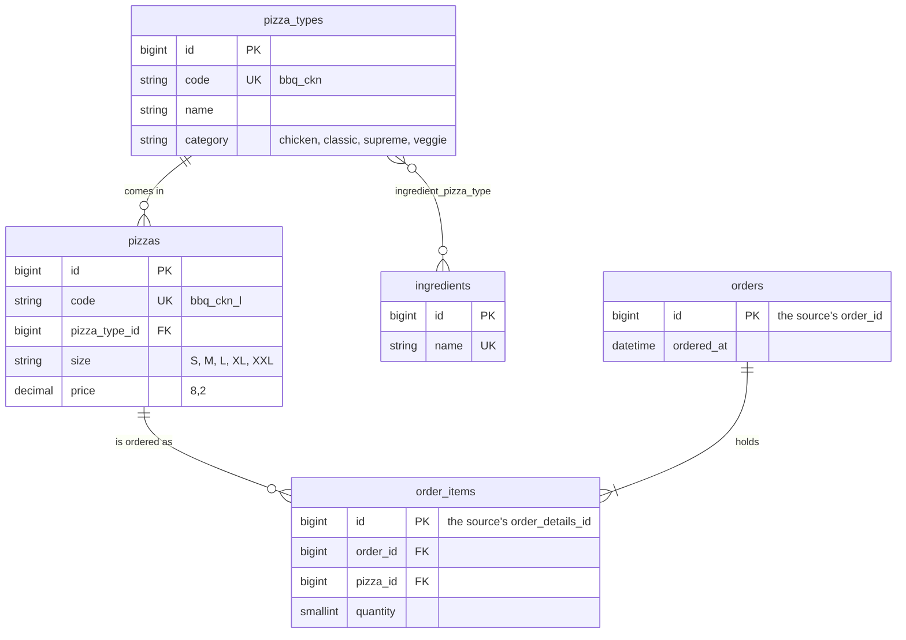

# Pizza Place Sales

A REST API and a dashboard over a year of orders from a fictitious pizza place.
Laravel imports the dataset's four CSV files and serves them as JSON; a Vue 3
dashboard, behind a login, charts the sales and lists, searches and filters the
orders through that API. The whole stack runs in Docker.

- [Running it locally](#running-it-locally)
- [What it does](#what-it-does)
- [The data and the schema](#the-data-and-the-schema)
- [The import](#the-import)
- [The API](#the-api)
- [The dashboard](#the-dashboard)
- [How the code is laid out](#how-the-code-is-laid-out)
- [Tests and formatting](#tests-and-formatting)
- [Decisions and trade-offs](#decisions-and-trade-offs)

## Running it locally

The whole stack runs in Docker; the host needs only Docker with Compose v2.
Composer, artisan and npm run inside the containers.

```bash
git clone https://github.com/ijay-bm/pizza-place-sales.git
cd pizza-place-sales
cp .env.example .env
cp apps/api/.env.example apps/api/.env
docker compose -f docker-compose.local.yml up -d --build
docker compose -f docker-compose.local.yml exec -u app php php artisan key:generate
docker compose -f docker-compose.local.yml exec -u app php php artisan migrate --seed --seeder="Database\Seeders\Local\DemoSeeder"
```

The application is then at <http://localhost:8080>. Log in as
`demo@pizza-place-sales.test` with the password `password`.

The last command creates that account and imports the full dataset, which is
committed under `apps/api/database/seeders/Local/pizza-place-sales/`, so no
Kaggle account is needed. To start again from an empty database, run the same
command with `migrate:fresh` in place of `migrate`.

- The root `.env` is read by Docker Compose alone: the host ports and the
  database account. Its `DB_*` values must equal the `DB_*` lines in
  `apps/api/.env`, which is Laravel's.
- If your user id is not 1000 (`id -u`), set `UID` and `GID` in the root `.env`
  before the first `up`, so files the containers write stay yours.
- The first `up` installs the PHP and Node dependencies, which takes a minute;
  `docker compose -f docker-compose.local.yml logs -f node` shows when Vite is
  ready.
- Port 8080 is the app, and MySQL listens on `127.0.0.1:3306` (user
  `pizza_place_sales`, password `secret`) for a database client.

| Service | What it runs |
|---|---|
| `nginx` | the only published port: `/api`, `/sanctum` and `/docs` go to PHP, everything else to Vite |
| `php` | php-fpm 8.5 serving Laravel 13 from `apps/api` |
| `composer` | `composer install`, once, before `php` starts |
| `node` | the Vite dev server for the Vue app in `apps/web` |
| `mysql` | MySQL 8.4, the application's database |
| `mysql-test` | MySQL 8.4 for the test suite, held in memory |

Every file is named `local` (`docker-compose.local.yml`,
`docker/nginx/nginx.local.conf`, the Dockerfile's `base` stage), so a staging or
production configuration can sit beside it without changing it.

## What it does

| Feature | Where |
|---|---|
| Log in and out | `/login`, `POST /api/v1/auth/login` |
| See revenue, orders, pizzas sold and the average order, with charts by month, category, hour and weekday, and the best and worst sellers, for any date range | the Dashboard, `GET /api/v1/statistics/*` |
| Import the dataset's four CSV files | the Import page, or `POST /api/v1/imports` |
| List orders with their totals, newest first, 25 to a page | the Orders page, `GET /api/v1/orders` |
| Search by order number, pizza type or ingredient | the Search box, `filter[search]` |
| Filter by date range, category, size and pizza type | the filters above the table, `filter[...]` |
| Sort by order number, date or total | the column headers, `sort` |
| Open an order with its pizzas and amounts, each linking to its pizza type | `/orders/{id}`, `GET /api/v1/orders/{id}` |
| Browse the 32 pizza types with their sizes, prices and ingredients, searched by name or ingredient | the Menu page, `GET /api/v1/pizza-types` |
| Read and try the API | <http://localhost:8080/docs/api> |

## The data and the schema

The dataset is [Pizza Place Sales on Kaggle](https://www.kaggle.com/datasets/mysarahmadbhat/pizza-place-sales):
a year of orders, 2015, in four related files.

| File | Rows | Columns |
|---|---|---|
| `pizza_types.csv` | 32 | `pizza_type_id`, `name`, `category`, `ingredients` |
| `pizzas.csv` | 96 | `pizza_id`, `pizza_type_id`, `size`, `price` |
| `orders.csv` | 21,350 | `order_id`, `date`, `time` |
| `order_details.csv` | 48,620 | `order_details_id`, `order_id`, `pizza_id`, `quantity` |



The dataset already arrives as four related tables with their own keys, so the
schema follows them, and changes them where the files fall short:

| From the files | In the schema | Why |
|---|---|---|
| a pizza type's ingredients in one comma-separated text field | an `ingredients` table and the `ingredient_pizza_type` pivot | the one place the source holds a list in a field; as rows, "which pizzas use mushrooms" is an ordinary query, and an ingredient is searchable |
| `date` and `time` as two strings | one `ordered_at`, a `DATETIME`, indexed | one sortable, filterable moment; date ranges use the index |
| `order_id`, `order_details_id` | kept as the primary keys of `orders` and `order_items` | an order keeps its number from one import to the next, and `order_items.order_id` needs no translation |
| `pizza_type_id`, `pizza_id` as text | numeric `id`s, with the text kept as a unique `code` | Laravel's usual keys for relations, while the codes still identify the rows on a re-import |
| `category` and `size` as free text | strings cast to the PHP enums `PizzaCategory` and `PizzaSize`, checked by the import | a value outside the list never gets in; a change to the list is a code change, not a migration |
| relations implied by matching values | foreign keys, and a unique (`pizza_type_id`, `size`) on `pizzas` | the database refuses a line for a pizza that does not exist, or two prices for one size |

`order_items` has no price column: the dataset has one price per pizza, so
revenue is `quantity × pizzas.price`.

**No time zone.** The times are the shop's wall-clock times as the dataset
records them, and it names no time zone. `ordered_at` is a `DATETIME`, which
stores the time as given (a `TIMESTAMP` would convert it through UTC), the API
sends it without an offset, and the dashboard shows it as written. Converting it
to the viewer's zone would move the lunch rush with whoever is looking.

## The import

`POST /api/v1/imports` takes the four files together, as the fields
`pizza_types`, `pizzas`, `orders` and `order_details`; the Import page sends the
same request, and files dropped on it go to the slot with their exact name.

- **Every header is checked first**, so a request with several wrong files names
  each one at once.
- **One transaction**, in the order the files refer to each other: pizza types
  and their ingredients, pizzas, orders, order lines. A row that cannot be read
  (an unknown pizza, a bad date, a missing field) stops the import with a 422 on
  that file, naming the line, and nothing is written:

  ```json
  { "message": "Line 3: the pizza bbq_ckn_l is not in pizzas.csv.", "errors": { "order_details": ["Line 3: the pizza bbq_ckn_l is not in pizzas.csv."] } }
  ```

- **An import replaces the sales data.** Inside the same transaction the rows
  already stored are deleted, then the files are inserted with their source ids,
  so importing the same files again leaves the same rows, and a refused import
  leaves the stored data as it was.
- **`pizza_types.csv` is saved in Windows-1252**, not UTF-8: its Calabrese
  pizza lists `‘Nduja Salami` with a curly quote. A field that is not valid UTF-8
  is converted before it is stored.
- **The full dataset imports in about three seconds.** Rows are read one at a
  time and written a thousand at a time.

The demo seeder imports the committed files through the same importer.
`*.csv -text` in `apps/api/.gitattributes` keeps git from changing their CRLF
line endings.

## The API

Every route is under `/api/v1`, and everything but login answers to a signed-in
session. The dashboard signs in with Sanctum's session cookie; any client that
keeps the cookie can do the same:

```bash
curl -c cookies.txt http://localhost:8080/sanctum/csrf-cookie
# The XSRF-TOKEN cookie's value, URL-decoded, goes back as the X-XSRF-TOKEN header on every POST.
curl -b cookies.txt -c cookies.txt http://localhost:8080/api/v1/auth/login \
  -H 'Accept: application/json' -H 'Origin: http://localhost:8080' \
  -H "X-XSRF-TOKEN: <the XSRF-TOKEN cookie's value>" -H 'Content-Type: application/json' \
  -d '{"email": "demo@pizza-place-sales.test", "password": "password"}'
```

The simpler way to try it is the generated documentation at
<http://localhost:8080/docs/api>, opened in the browser where the dashboard is
signed in: its requests carry the same session.

| Route | Returns |
|---|---|
| `POST auth/login`, `POST auth/logout`, `GET auth/user` | the signed-in user; five login attempts a minute per email and address |
| `POST imports` | the rows each table received |
| `GET orders` | a page of orders with `pizza_count` and `total` |
| `GET orders/{orderId}` | one order with its totals |
| `GET pizza-types` | the pizza types with their sizes, prices and ingredients, for the menu and the dashboard's filter lists |
| `GET statistics/summary` | revenue, orders, pizzas sold, the average order value and pizzas per order |
| `GET statistics/revenue-by-month` | every month from the first to the last in the range, with its revenue and orders; zeros for a month that sold nothing |
| `GET statistics/orders-by-hour` | the orders placed in each hour of the day |
| `GET statistics/orders-by-weekday` | the orders placed on each day of the week, `1` for Monday to `7` for Sunday |
| `GET statistics/pizza-type-sales` | every pizza type with the pizzas it sold and its revenue, the best-selling first; a type that sold nothing is listed with zeros |
| `GET statistics/category-sales` | each category with the pizzas it sold and its revenue |

`GET orders` reads `filter[ordered_from]`, `filter[ordered_to]` (dates),
`filter[category]`, `filter[size]`, `filter[pizza_type]` (a code) and
`filter[search]`; `sort` (`ordered_at`, `total`, `id`, `-` for descending);
`per_page` (up to 100) and `page`. Both order routes take
`include=orderItems.pizza.pizzaType` for each order's lines. An unknown filter,
sort or include is a 400, an invalid value a 422 on its field.

Every `statistics/*` route takes `filter[ordered_from]` and `filter[ordered_to]`,
both optional and both included; any other filter is a 422. Hours and weekdays
are summed across every year in the range, since they answer when the shop is
busy.

The pizza filters describe one pizza: `filter[size]=L&filter[category]=classic`
finds orders holding a large classic pizza, not any large pizza beside any
classic one. A search of digits only is an order number; any other search
matches a pizza's name or one of its ingredients, and `%` and `_` in it match as
typed.

```http
GET /api/v1/orders?filter[search]=Nduja&filter[size]=L&sort=-total&per_page=2
```

The response, with its links shortened and `meta.links` left out:

```json
{
  "data": [
    { "id": 6169, "ordered_at": "2015-04-14T13:14:51", "pizza_count": 15, "total": "284.00" },
    { "id": 5452, "ordered_at": "2015-04-02T12:58:32", "pizza_count": 15, "total": "267.10" }
  ],
  "links": { "first": "…&page=1", "last": "…&page=137", "prev": null, "next": "…&page=2" },
  "meta": { "current_page": 1, "from": 1, "last_page": 137, "per_page": 2, "to": 2, "total": 274 }
}
```

Money is returned as decimal strings, not floats.

## The dashboard

A Vue 3 single-page application in `apps/web`: TypeScript, Vue Router, Pinia,
Tailwind CSS 4, axios and Chart.js, served by Vite in development.

- **Dashboard** shows revenue, orders, pizzas sold and the average order, bar
  charts of revenue by month and by category and of orders by hour and by day of
  the week, and the five best and worst sellers. A date range narrows every
  figure and lives in the address; months carry their year once the range spans
  more than one. Charts are Chart.js through vue-chartjs.
- **Orders** lists the orders with their date, total, pizzas and count. The
  search, the filters, the sort and the page live in the address, so a search
  can be bookmarked or shared and survives a reload; the search waits for typing
  to stop, and a newer request cancels an older one.
- **An order** lists its pizzas with category, size, price, quantity and amount;
  each pizza links to its type on the menu, with the size bought highlighted.
- **Menu** lists the pizza types by category with their sizes, prices and
  ingredients, narrowed as you type a name or an ingredient. Each type links to
  the orders that hold it.
- **Import** takes the four files, chosen or dropped, and lists the rows each
  table received, or each file's error under its slot.
- Login guards every page: the router asks `GET auth/user` once per page load,
  and a 401 later sends the user back to log in.
- Light and dark themes follow the system or the toggle in the header.

## How the code is laid out

```
apps/api                 Laravel 13
  app/Http/Controllers/Api/V1   one thin controller per resource
  app/Http/Requests/Api/V1      validation of every request
  app/Http/Resources/Api/V1     the JSON every endpoint returns
  app/Imports                   SalesDataImporter, CsvFile
  app/Queries                   OrderQuery (the orders' filters, sorts and includes), SalesStatistics
  app/Models, app/Enums
  database/seeders/Local        the demo seeder and the dataset it imports
  tests/Feature                 one test class per controller method
  tests/Fixtures/imports        small CSV files cut from the dataset
apps/web                 Vue 3
  src/api         the axios client and one module per resource
  src/views       one component per route
  src/layouts     the signed-in frame
  src/components  shared form components and the bar chart
  src/stores      the auth store
  src/utils       formatters for money, dates and names
docker                   the PHP image, nginx and PHP settings
```

## Tests and formatting

```bash
docker compose -f docker-compose.local.yml exec -u app php php artisan test
```

The front end's unit tests run with Vitest:

```bash
docker compose -f docker-compose.local.yml exec node npm run test:unit
```

The API's tests call it over HTTP against the `mysql-test` database, the same
engine the app uses. Each endpoint is tested signed out where it needs a session
(401), with invalid input where it takes any (422) and on its happy path, with
numbers checked by hand against small fixtures cut from the dataset; one test
imports the full dataset and checks its row counts.

Prettier formats the TypeScript, Vue and CSS, and the PHP through
`@prettier/plugin-php`; Pint runs after it on the PHP and has the last word, so
the PHP follows Laravel's style. Run both, in this order:

```bash
docker compose -f docker-compose.local.yml exec node npm run format
docker compose -f docker-compose.local.yml exec -u app php vendor/bin/pint
```

The checks are `npm run format:check` and `npm run type-check` for the front end,
and `vendor/bin/pint --test` for the PHP.

## Decisions and trade-offs

- **The import runs inside the request, not in a queue.** The full dataset takes
  about three seconds, and the response carries the row counts or the errors
  directly. Each file is capped at 10 MB; much bigger files would need a queued
  job and a status to poll.
- **An import replaces everything.** All four files are required, so every
  import is a whole dataset: the old rows are deleted and the new ones inserted
  in one transaction, and a bad row leaves the old data untouched. The catch is
  that a second year can't be added on top of the first.
- **No price on the order lines.** The dataset has one price per pizza for the
  whole year, so revenue is `quantity × pizzas.price`. If the app took orders
  while prices changed, each line would need its own price.
- **No time zone.** The source doesn't name one, so `ordered_at` holds the
  shop's local time and the dashboard shows it as is. A second location would
  need UTC plus a time zone per shop.
- **Category and size are PHP enums over string columns, not MySQL `ENUM`s.**
  Changing either list is a code change rather than a migration, but the
  database won't reject a bad value on its own, so the importer checks each one.
- **The pizza filters describe one pizza.** Size L with category Classic means a
  large classic pizza, not a large pizza next to a classic one. The matching
  pizza ids are read first and the orders matched on the indexed
  `order_items.pizza_id`; nested `whereHas` queries took over three seconds.
- **Sanctum's session cookie, no API tokens.** That suits the SPA. A mobile app
  or another service would need Sanctum's personal access tokens added.
- **No CI and no production setup.** Only the local Docker configuration exists.
  A pipeline running the tests and checks would come first, then a production
  image.

Libraries beyond Laravel and Vue: `spatie/laravel-query-builder` for `filter`,
`sort` and `include`, Scramble for the API documentation, Chart.js through
`vue-chartjs`, and Tailwind CSS without a component library.

Work is committed on `develop`, the only long-lived branch. Each feature was
built on its own `feature/*` branch and merged with `--no-ff`.
